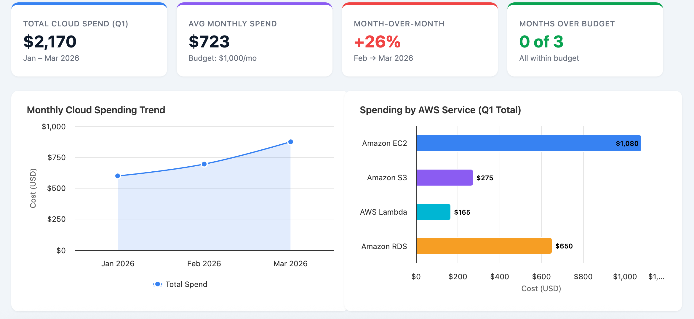
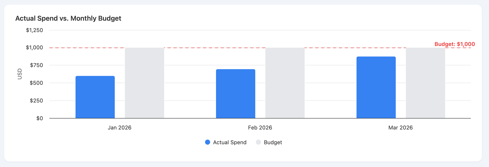
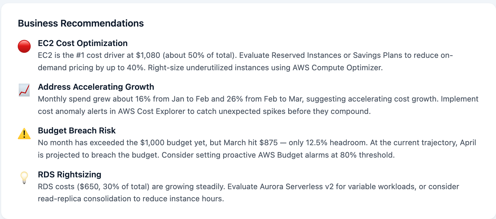

# aws-cloud-cost-analytics
Beginner AWS cloud financial analytics project using Python, Pandas, Amazon S3, and cloud cost management concepts.


## Day 1 – GitHub & Codespaces Setup

### Overview
Today focused on establishing the development environment and creating the GitHub repository for the AWS Cloud Cost & Business Analytics project.

### What We Accomplished

1. **Created a GitHub Account**
   - Established a GitHub account to host and manage project files.
   - Learned how GitHub can be used to showcase technical projects to recruiters and employers.

2. **Created a GitHub Repository**
   - Repository Name: `aws-cloud-cost-analytics`
   - Created a public repository to store project code, datasets, documentation, and reports.
   - Initialized the repository with a README.md file.

3. **Configured GitHub Codespaces**
   - Created a Codespace directly from the GitHub repository.
   - Established a cloud-based development environment using a browser-based VS Code interface.
   - Identified the three primary development areas:
     - **Explorer:** Organizes and displays project files and folders.
     - **Editor:** Used to write and modify code.
     - **Terminal:** Used to execute commands and run scripts.

4. **Created the Project Directory Structure**

   ```text
   aws-cloud-cost-analytics/
   │
   ├── data/
   ├── src/
   ├── reports/
   ├── screenshots/
   ├── README.md
   └── requirements.txt
   ```

   - `data/` – Stores datasets and CSV files.
   - `src/` – Stores Python scripts and project source code.
   - `reports/` – Stores generated analytical reports.
   - `screenshots/` – Stores dashboard images and project screenshots.
   - `README.md` – Documents the project, objectives, and progress.
   - `requirements.txt` – Lists Python libraries required by the project.

### Technologies Introduced

| Technology | Purpose |
|---|---|
| GitHub | Project hosting and version control |
| GitHub Codespaces | Cloud-based development environment |
| VS Code | Code editing interface |
| Python | Programming language for data analysis |
| AWS | Cloud platform used for the project |

### Key Takeaways

- Learned how to create and manage a GitHub repository.
- Established a cloud-based development environment using Codespaces.
- Learned the basic layout of the VS Code interface.
- Created an organized directory structure for a data analytics project.
- Established the foundation for developing Python scripts and working with AWS services.

### Next Steps – Day 2

- Verify the Python installation in Codespaces.
- Install the Pandas library.
- Create the initial cloud spending CSV dataset.
- Begin learning Python fundamentals and basic data manipulation.
- Prepare the project for its first data analysis script.

## Amazon QuickSight Dashboard

Built with Amazon Quick Apps using simulated spending data.





## Day 3 — Amazon S3 Bucket Configuration & Security Review

**Objective:** Gain hands-on experience reviewing Amazon S3 storage configurations, security settings, and operational best practices.

### Tasks Completed

- Verified the `cloud_spending.csv` dataset was stored in Amazon S3.
- Reviewed Block Public Access settings and bucket permissions.
- Confirmed Object Ownership was set to Bucket owner enforced.
- Verified server-side encryption using SSE-S3.
- Identified that S3 Bucket Versioning was disabled.
- Documented findings in a technical review.

### Skills Developed

- Amazon S3 administration
- Cloud security fundamentals
- AWS infrastructure inspection
- Cloud operations and troubleshooting documentation

### Documentation

[View Day 3 — S3 Bucket Review](docs/s3-bucket-review.md)

## Day 4 — AWS CLI & S3 Troubleshooting

**Objective:** Develop hands-on experience using the AWS Command Line Interface (CLI) to inspect cloud resources, verify S3 configurations, and troubleshoot common setup issues.

### Tasks Completed

- Installed and configured AWS CLI v2.40.0 in GitHub Codespaces.
- Authenticated to AWS using browser-based login.
- Verified AWS identity using AWS Security Token Service (STS).
- Listed existing S3 buckets and confirmed that `cloud_spending.csv` was stored in the project bucket.
- Inspected S3 Bucket Versioning through AWS CLI.
- Verified all four Block Public Access settings were enabled.
- Confirmed default server-side encryption using SSE-S3 (AES256).
- Verified that SSE-C encryption was blocked.
- Troubleshot AWS CLI installation and authentication errors.

### AWS Skills Developed

- AWS CLI commands and terminal navigation
- Amazon S3 resource administration
- AWS STS and authentication fundamentals
- Cloud storage security configuration
- Command-line troubleshooting
- Technical documentation

### Documentation

[View Day 4 — AWS CLI & S3 Configuration Review](docs/aws-cli-s3-review.md)

## Day 5 — AWS S3 Troubleshooting Lab

**Objective:** Practice diagnosing and resolving common AWS CLI and Amazon S3 issues using real command-line troubleshooting scenarios.

### Tasks Completed

- Identified and resolved an expired AWS authentication session.
- Reauthenticated to AWS using browser-based login.
- Verified S3 object availability using `head-object`.
- Reproduced an HTTP 404 error by requesting an incorrect S3 object key.
- Investigated bucket contents using recursive object listing.
- Identified the root cause of the missing-object error.
- Corrected the object key and verified successful access.
- Documented troubleshooting steps, root causes, resolutions, and verification results.

### AWS Skills Developed

- AWS CLI troubleshooting
- Amazon S3 administration
- AWS STS and authentication
- Error investigation
- Root cause analysis
- Technical documentation

### Documentation

[View Day 5 — AWS S3 Troubleshooting Lab](docs/day-5-s3-troubleshooting.md)